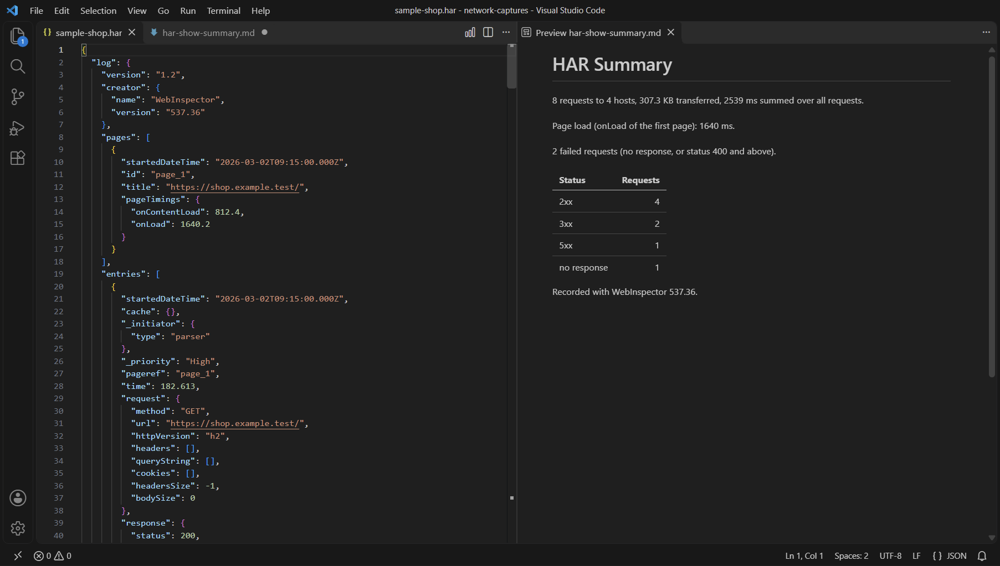
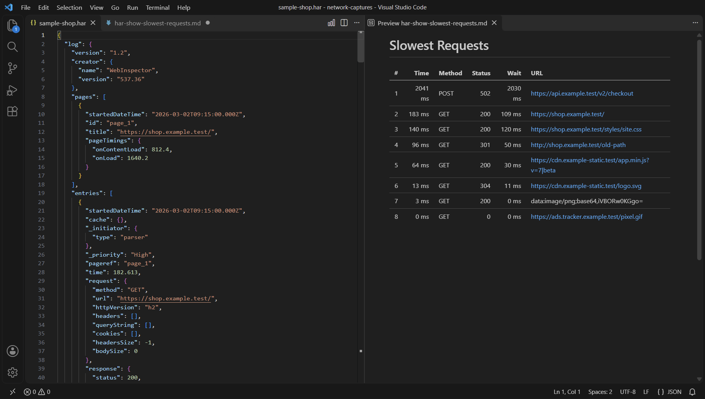
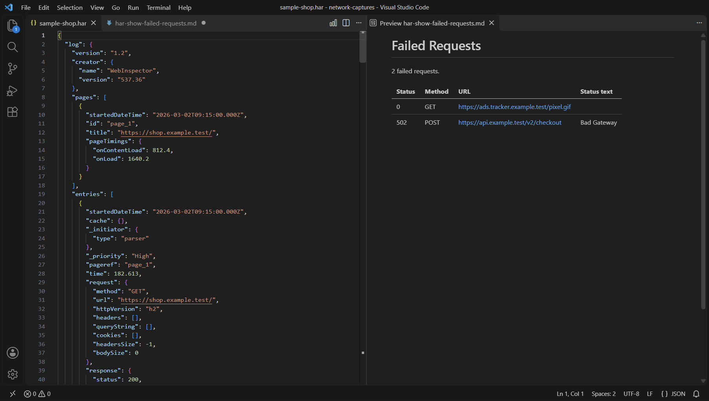
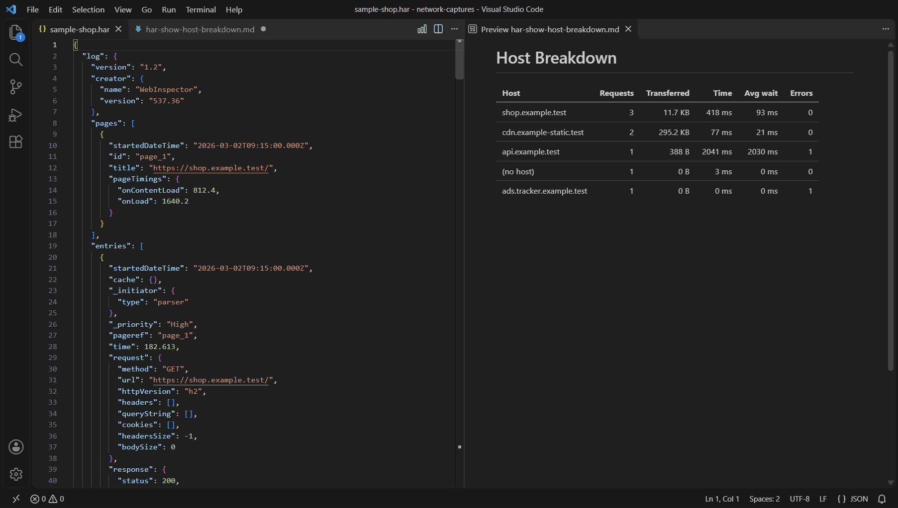
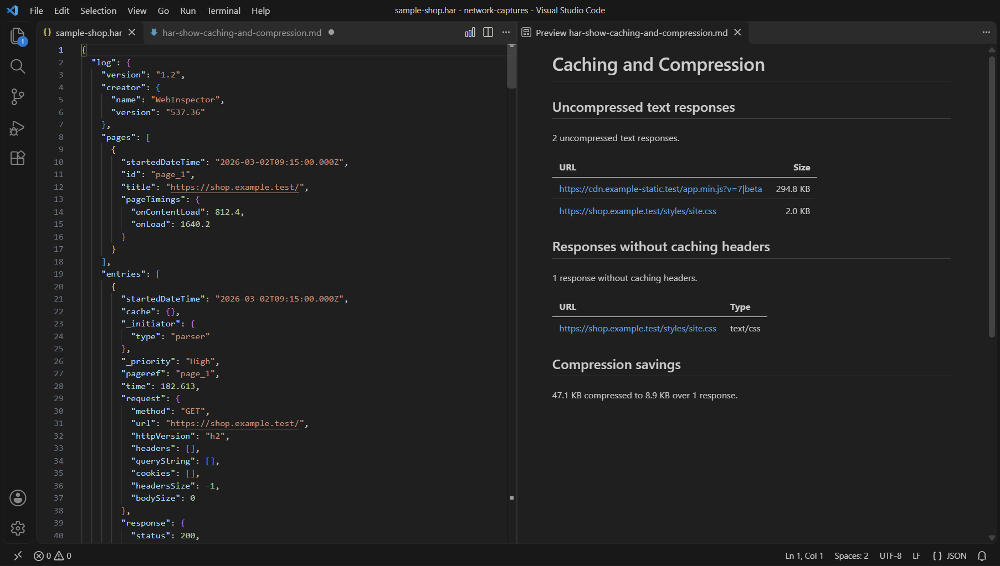

# HAR Atlas

HAR Atlas reads HAR files (HTTP Archive, the file a browser's network panel saves) and turns them into clear Markdown reports: what was loaded, what failed, what was slow and why, which hosts cost the most, and which responses were sent without compression or caching headers. Useful when a customer or a colleague sends you a HAR file and asks why a page is slow or broken.

Everything runs on your computer. There is no telemetry. The only network request the extension ever makes is the licence check for the optional Pro tier (see [Privacy](PRIVACY.md)).

## What it does

* **Show Summary**: The whole capture at a glance: how many requests went to how many hosts, how much was transferred, how many failed and the browser's page load time.
* **Show Failed Requests**: Every request that got no response or an error status, with its method, URL and status text.
* **Show Slowest Requests**: The ten slowest requests, with the wait time (time to first byte) next to the total.
* **Show Host Breakdown** (Pro): Per host: requests, transferred bytes, time, average wait and errors, to see which server or third party costs the most.
* **Show Caching And Compression** (Pro): Text responses sent without compression, responses without caching headers, and how much compression saved.

## Free, trial and Pro

| Feature | Free | Pro |
| --- | :---: | :---: |
| Show Summary | yes | yes |
| Show Failed Requests | yes | yes |
| Show Slowest Requests | yes | yes |
| Show Host Breakdown |  | yes |
| Show Caching And Compression |  | yes |
| Open Sample File, walkthrough, Report A Problem | yes | yes |

The free reports need no key, no account and no network connection, and they will not be moved behind the licence key later. The first Pro command starts a **free 14-day trial** on this computer. After that, Pro is a one-time purchase, not a subscription: **Pro Personal USD 19** (one person, use at work allowed) or **Pro Business USD 39 per user** (one key per user of an organisation). A key works on up to 3 computers. The checkout page shows the final price and any taxes for your country. Licence keys are sold by Dodo Payments, the merchant of record. Details: [licence](docs/licence.md), [terms](TERMS.md).

## Commands

Open the Command Palette and type `HAR Atlas`.

| Command | Tier |
| --- | :---: |
| HAR Atlas: Show Summary | Free |
| HAR Atlas: Show Failed Requests | Free |
| HAR Atlas: Show Slowest Requests | Free |
| HAR Atlas: Show Host Breakdown | Pro |
| HAR Atlas: Show Caching And Compression | Pro |
| HAR Atlas: Open Sample File | Free |
| HAR Atlas: Open Walkthrough | Free |
| HAR Atlas: Show Documentation | Free |
| HAR Atlas: Report A Problem | Free |
| HAR Atlas: Buy Pro | Free |
| HAR Atlas: Enter Licence Key | Free |
| HAR Atlas: Show Licence Status | Free |
| HAR Atlas: Remove Licence From This Machine | Free |

## Settings

| Setting | Default | Meaning |
| --- | --- | --- |
| `harAtlas.maxFileSizeMB` | 50 | Largest file a report reads (0.1 to 50 MB; VS Code passes files only up to 50 MB to extensions). |
| `harAtlas.openReportsAsPreview` | true | Open each report in the Markdown preview as well. |

## FAQ

**Does HAR Atlas upload my HAR file?**
No. Every report is created on your computer from the text in the editor. HAR files often hold cookies and tokens, so nothing about them leaves your computer.

**Which browsers' HAR files work?**
Any HAR 1.2 file: Chrome, Edge, Firefox, Safari and tools that write the same format. Fields a browser leaves out are shown as 0 or -.

**Why do the hosts not add up to the number of requests?**
They do: requests without a host (data: and blob: URLs) are counted in a row named (no host).

**What does Wait mean in Slowest Requests?**
The wait phase of the HAR timings: the time from sending the request to the first byte of the answer (time to first byte).

## For IT and procurement

* Publisher: SmallStepsStudio (Visual Studio Marketplace), smallstepsstudio (Open VSX).
* Network: one host, `live.dodopayments.com`, for the licence check only, and only after a key is entered. No telemetry. The trial uses no network.
* Files are read from the editor only; the extension writes no files and changes none.
* Source: <https://github.com/small-steps-studio/har-atlas>.
* Licence agreement: [LICENSE.txt](LICENSE.txt). Terms: [TERMS.md](TERMS.md). Privacy: [PRIVACY.md](PRIVACY.md).

## Support

Run **HAR Atlas: Report A Problem** or open an issue at <https://github.com/small-steps-studio/har-atlas/issues>. Never post a licence key or confidential data in a public issue.

HAR (HTTP Archive) is an open file format written by web browsers and developer tools; HAR Atlas is an independent product and is not affiliated with or endorsed by any browser vendor.
